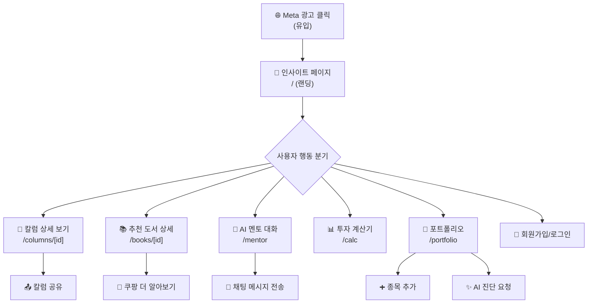

# 🎯 The Lazy Rich — Meta Pixel 이벤트 설정 전략 가이드 (최종)

## 현재 상태

| 항목 | 상태 |
|------|------|
| Meta Pixel 설치 | ✅ 설치됨 (ID: `3038083086378797`) |
| PageView 자동 트래킹 | ✅ 작동 중 (SPA 라우트 변경 시 자동 발화) |
| 커스텀 이벤트 | ❌ 미설정 |

---

## 앱 사용자 여정 (User Funnel)



---

## 추천 이벤트 설정 (우선순위별)

### 🔴 P0 — 핵심 전환 이벤트 (반드시 설정)

> Meta 광고 최적화의 핵심입니다. 이 이벤트들이 있어야 Meta가 "전환 가능성이 높은 유사 타깃"을 학습할 수 있습니다.

| # | 이벤트명 | Meta 표준 이벤트 | 발화 시점 | 발화 위치 | 설명 |
|---|---------|-----------------|-----------|-----------|------|
| 1 | **회원가입 완료** | `CompleteRegistration` | Google/Kakao 로그인 성공 시 | `AuthContext.tsx` — 로그인 성공 콜백 | 신규 유저 획득의 핵심 지표. "가입 최적화" 캠페인에 직접 사용 |
| 2 | **AI 멘토 대화 시작** | `Lead` | 멘토 캐릭터 선택 시 | `mentor/page.tsx` — `handleMentorSelect()` | 앱 핵심 가치인 AI 멘토를 처음 사용하는 순간 |
| 3 | **종목 추가 완료** | `AddToCart` | 포트폴리오에 종목 추가 확인 시 | `AddStockDialog.tsx` — 종목 추가 확인 | 자산 데이터를 커밋하는 높은 참여도 신호 |

---

### 🟡 P1 — 주요 참여 이벤트 (강력 추천)

> Meta의 "참여 최적화" 캠페인에 활용하거나, 리타겟팅 유사 타깃 구축에 유용합니다.

| # | 이벤트명 | Meta 표준 이벤트 | 발화 시점 | 발화 위치 | 설명 |
|---|---------|-----------------|-----------|-----------|------|
| 4 | **칼럼 상세 조회** | `ViewContent` | 칼럼 상세 페이지 진입 시 | `columns/[id]/page.tsx` | `content_type: 'column'`으로 구분 |
| 5 | **추천 도서 상세 조회** | `ViewContent` | 도서 상세 페이지 진입 시 | `books/[id]/page.tsx` | `content_type: 'book'`으로 구분. 쿠팡 파트너스 수익 기여 측정 가능 |
| 6 | **투자 계산기 사용** | `Search` | 계산 실행 버튼 클릭 시 | `calc/page.tsx` | `search_string` 파라미터에 계산기 종류 기록 |
| 7 | **AI 멘토 채팅 전송** | `Contact` | 메시지 전송 시 | `ChatInterface.tsx` | `Lead`와 구분하여 깊은 참여 추적 |
| 8 | **포트폴리오 AI 진단** | `Subscribe` | 멘토 선택 후 진단 시작 시 | `portfolio/page.tsx` — `handleMentorSelect()` | 가장 높은 참여도 행동 |

---

### 🟢 P2 — 보조 이벤트 (선택 사항)

> 아래는 모두 **커스텀 이벤트**입니다 (`fbq('trackCustom', ...)`). 표준 이벤트 대비 ML 학습 효율은 낮지만, 리타겟팅 오디언스 구축에 활용 가능합니다.

| # | 이벤트명 | 이벤트 종류 | 발화 시점 | 설명 |
|---|---------|-----------|-----------|------|
| 9 | **시장 상황 조회** | 커스텀: `ViewMarket` | 인사이트 → 시장 상황 탭 클릭 | 시장 관심도 파악 |
| 10 | **칼럼 공유** | 커스텀: `Share` | 칼럼 상세 → 공유 버튼 클릭 | ⚠️ 공유 버튼 UI 구현 선행 필요. 바이럴 행동 추적 |
| 11 | **포트폴리오 방문** | 커스텀: `ViewPortfolio` | /portfolio 라우트 진입 | 핵심 기능 관심도 |
| 12 | **도서 외부 링크 클릭** | 커스텀: `OutboundClick` | 도서 상세 → "더 알아보기" 쿠팡 CTA 클릭 | 쿠팡 파트너스 수익과 직결 |

---

## 구현 방향 제안

### 코드 구조

```
src/lib/analytics.ts          ← 이벤트 헬퍼 함수 모듈 (신규 생성)
src/components/analytics/
  └── AnalyticsManager.tsx     ← 기존 유지 (PageView 처리)
```

### 헬퍼 함수

```typescript
// src/lib/analytics.ts

/** Meta 표준 이벤트 발화 (P0, P1에 사용) */
export function trackMetaEvent(
  eventName: string, 
  params?: Record<string, any>
) {
  if (typeof window !== 'undefined' && typeof window.fbq === 'function') {
    window.fbq('track', eventName, params);
  }
}

/** Meta 커스텀 이벤트 발화 (P2에 사용) */
export function trackMetaCustomEvent(
  eventName: string, 
  params?: Record<string, any>
) {
  if (typeof window !== 'undefined' && typeof window.fbq === 'function') {
    window.fbq('trackCustom', eventName, params);
  }
}
```

### 사용 예시

```typescript
// ✅ P0 — 회원가입 완료 시 (AuthContext.tsx)
trackMetaEvent('CompleteRegistration', {
  content_name: 'google',  // 또는 'kakao'
  status: true,
});

// ✅ P0 — AI 멘토 대화 시작 시 (mentor/page.tsx)
trackMetaEvent('Lead', {
  content_name: mentor.name,
  content_category: 'ai_mentor',
});

// ✅ P0 — 종목 추가 시 (AddStockDialog.tsx)
trackMetaEvent('AddToCart', {
  content_name: stockName,
  content_type: 'stock',
  content_ids: [ticker],
});

// ✅ P1 — 칼럼 상세 조회 시 (columns/[id])
trackMetaEvent('ViewContent', {
  content_name: column.title,
  content_type: 'column',
  content_ids: [column.id],
});

// ✅ P1 — 추천 도서 상세 조회 시 (books/[id])
trackMetaEvent('ViewContent', {
  content_name: book.title,
  content_type: 'book',
  content_category: book.tag,  // e.g. '가치투자', '행동경제학'
  content_ids: [book.id],
});

// ✅ P2 — 쿠팡 외부 링크 클릭 시 (books/[id])
trackMetaCustomEvent('OutboundClick', {
  content_name: book.title,
  destination: 'coupang',
  link_url: book.link,
});
```

### 칼럼 공유 버튼 구현 (선행 작업)

P2의 `Share` 이벤트를 위해 칼럼 상세 페이지(`columns/[id]/page.tsx`)에 공유 버튼 UI를 먼저 구현해야 합니다.

**구현 위치**: 칼럼 상세 페이지 상단 헤더 우측 (BackButton 반대편)

**참고 구현**: 했제 계산기 V1의 `handleShare` 함수 (`RegretCalculator.tsx`)

```typescript
// columns/[id]/page.tsx — 헤더 우측에 공유 버튼 추가

// Web Share API 우선, 미지원 시 클립보드 복사 폴백
const handleShare = async () => {
  const shareData = {
    title: column.title,
    text: column.description,
    url: `https://thelazyrich.me/columns/${column.id}`,
  };

  if (navigator.share) {
    await navigator.share(shareData);
  } else {
    await navigator.clipboard.writeText(shareData.url);
    // 토스트 알림: "링크가 복사되었습니다"
  }

  // Meta Pixel 이벤트 발화
  trackMetaCustomEvent('Share', {
    content_name: column.title,
    content_type: 'column',
    content_ids: [column.id],
  });
};
```

**디자인**: 했제 계산기 V1의 공유 버튼과 동일한 스타일 (`Share2` 아이콘 + 라운드 버튼)

---

## 📊 Meta 광고 캠페인별 이벤트 매핑

| 캠페인 목표 | 최적화 이벤트 | 활용 시나리오 |
|------------|-------------|-------------|
| **신규 유저 확보** | `CompleteRegistration` | 가입 전환율 최적화 |
| **앱 참여도 증대** | `Lead` (AI 멘토 시작) | 핵심 기능 사용자 확보 |
| **콘텐츠 참여** | `ViewContent` | 칼럼/도서 콘텐츠 소비 유도 |
| **리타겟팅** | `ViewContent` → `Lead` 미전환 유저 | 칼럼만 보고 나간 유저를 AI 멘토로 유도 |
| **유사 타깃(LAL)** | `AddToCart` + `Lead` 유저 기반 | 종목 추가 + 멘토 사용 유저와 유사한 사람 타깃 |

---

## ⚡ 권장 실행 순서

```
1단계  analytics.ts 헬퍼 모듈 생성
2단계  P0 이벤트 3개 구현 (CompleteRegistration, Lead, AddToCart)
3단계  칼럼 상세 페이지 공유 버튼 UI 구현
4단계  Meta Events Manager에서 이벤트 수신 확인
5단계  광고 캠페인 세팅 및 테스트
6단계  P1 이벤트 5개 추가 구현
7단계  P2 이벤트 구현 (Share 포함)
8단계  데이터 축적 후 유사 타깃(LAL) 생성
```

---

## ⚠️ 주의사항

- **테스트 방법**: Meta [Events Manager](https://business.facebook.com/events_manager)의 "테스트 이벤트" 탭에서 실시간 수신 확인 가능합니다. 현재 `AnalyticsManager.tsx`에 `NODE_ENV !== "production"` 체크가 있으므로, 테스트 시에는 이 조건을 일시적으로 해제하거나 환경변수로 분리하는 것이 좋습니다.

- **중복 발화 방지**: React Strict Mode에서 `useEffect`가 2번 실행될 수 있습니다. 이벤트 발화 로직에 `useRef` flag를 사용한 중복 방지 처리를 권장합니다.

- **표준 vs 커스텀 구분 필수**: P0/P1 이벤트는 반드시 `fbq('track', ...)` (표준)으로, P2 이벤트는 `fbq('trackCustom', ...)` (커스텀)으로 발화해야 합니다. 존재하지 않는 이벤트명을 `track`으로 보내면 Meta에서 무시됩니다.
